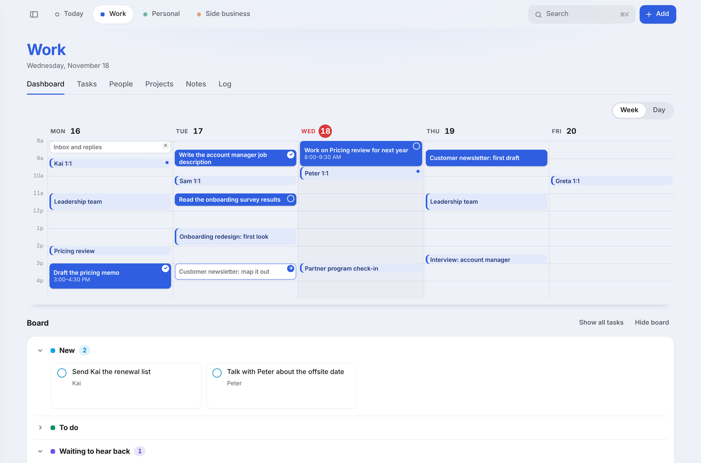
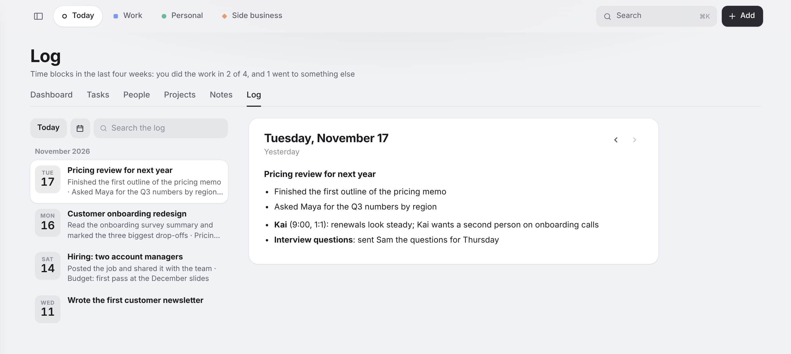
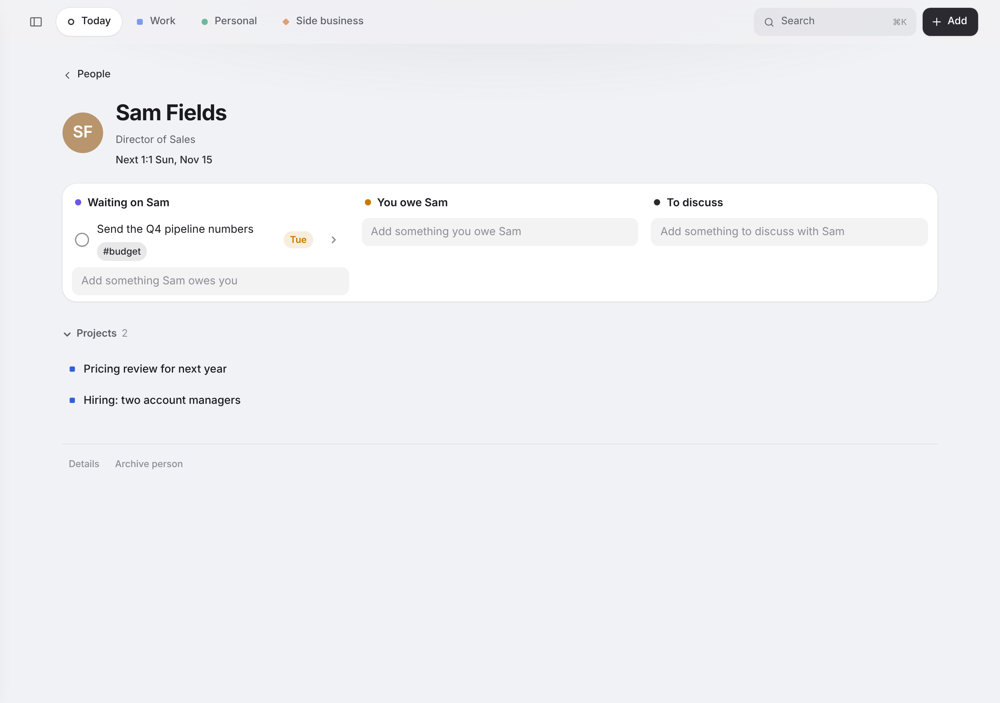

# Robot dashboard: run your work from a chat, see it on a dashboard

You manage everything by talking to your AI chatbot: Claude, Duet, Dots, or any assistant that
can add an MCP connector. "Add this: Sam owes me the pipeline numbers by Friday." "What should I
work on today?" "Go through my email and update my dashboard." The chatbot reads and writes one
database that you own.

That database is the **canonical record**: one place for your tasks, who you are waiting on, what
you owe people, what you want to raise with them, and your projects. The **dashboard** is a
website on top of it, for looking at where things stand and checking things off.

The idea is to get the best of both:

- **A chat is the fastest way to put things in and ask questions.** There are no forms to fill
  in, and you can say "the usual" and "move that to next week".
- **A chat is a poor place to keep things.** It forgets between conversations, and you can't
  see everything at a glance. The database remembers, and the dashboard shows it.
- **Every chat sees the same record.** Your phone, your laptop and a different AI all read and
  write the same data, and every change is logged with an Undo.

This is a working app that one person built for himself without writing any code. He described
what he wanted to an AI (Claude Code), tried it, and said what was wrong. It is shared so you can
do the same. **The names and data in this copy are made up.**

## How you use it

### In your chatbot (where you work)

Connect it once (see "Make your own" below). From then on, every chat knows how the dashboard
works, because the server hands your chatbot standing instructions when it connects. Talk to it
normally:

- "What should I work on today?" or "Plan my week."
- "Add this: send Kai the renewal numbers by Friday."
- "Greta owes me the launch plan." "Discuss the budget with Peter."
- "Prep me for my meeting with Sam."
- "What am I waiting on, and from whom?"
- "Go through my email and update my dashboard." It reads your mail with the chatbot's own email
  connection, shows you one short list of proposed changes, and waits for your yes before it
  writes anything.
- "Plan my week." It finds the open time between your meetings and proposes time blocks, and
  sets them only after your yes.
- "Add a note to my 2 o'clock: ..." or "add a task to my meeting with Sam."
- "Log that I finished the budget draft." "What did I do on Tuesday?" Every time you ask it to
  update the log, it looks again at the mail you sent, your calendar and your meeting notes, and
  writes the day up with one line for each thing you worked on. Meeting notes become a short
  summary of each meeting, never tasks.
- "I skipped the newsletter block and did the budget instead." It records how the time you set
  aside went.
- "That was wrong, undo it."

After each change it answers in one line with a link to that spot on the dashboard.

### On the dashboard (where you look)

Work, Personal and Side business are three desks, each with its own color.

- **Dashboard**: your planner. The morning brief and today's log, one line each; then your week
  (or one day) as a calendar, with your meetings and the time you set aside for tasks; and under
  it a board of rows you move tasks between: New, To do, Waiting, Back burner, To figure out.
  Drag a task onto the calendar, or click it and type "thu 9 45m", to give it time. Click a
  meeting to see who it is with, the tasks it carries and its note. Once time you set aside has
  begun, it asks "Did you get to it?": Yes, No, or Something else (and what). Each answer looks
  different on the week, so you can see at a glance which blocks you kept.
- **Tasks**: every task. A task is one line; people, a due date, tags, notes and a project are
  all optional. You can type a whole one: `Send the report @sam fri #budget`.
- **People**: for each person, the list for your next 1:1 with them and everything else they are
  on. A task that names someone shows up on their page by itself.
- **Projects** and **Notes**: plain lists.
- **Log**: your daily log, kept like a journal: a list of days to tap open, a Today button, a
  calendar of the days you logged, and a search. Each day is what you worked on, written up by
  your chatbot, with the things you told it folded in. Work on a project sits under the
  project's name, the same every day.

- **Activity**: every change, by you or by an AI, with Undo.

The only outside thing the website reads by itself is your Google Calendar, and that is
optional. It never reads or sends mail; your chatbot does that, in front of you.

## What it took to get here (read this before you build your own)

The first version of almost every part was wrong, and the fixes are the useful part. `CLAUDE.md`
records each decision with the reason. The short list:

1. **The chatbot is the main way in; the website is for looking.** In the first owner's words:
   "My primary interaction is with my chatbot... It's the most important thing." The website is
   "more like a dashboard where I can check off tasks."
2. **Nothing happens behind your back.** An earlier version checked email and meeting notes on
   a timer and drafted replies by itself. It was "too convoluted" and was taken out. Now the
   chatbot does that when asked, and shows its proposed changes first.
3. **Most things are a task, not a project.** "Not everything is a project. Sometimes it's just
   a task. Actually, oftentimes it's just a task."
4. **People work like tags.** A task can involve several people. Being on it only means it
   involves them; a person can be marked as the one you are waiting on, or the task can go on
   the list for your next 1:1 with them. Sorted lists ("waiting on", "I owe", "to discuss") were
   built and rejected.
5. **The database has to answer exact questions.** One kind of record per kind of thing, people
   matched by exact name (with other spellings saved, because dictation writes "Nena" for Nina).
   The chatbot never guesses a person: if a name fits two, it asks.
6. **Bare minimum on screen.** "This is my project manager. This is not a CRM." A ten-tile
   dashboard was "so busy", and nobody knew what "Project pulse" meant.
7. **Plan with time blocks.** After Cal Newport: meetings are fixed, and the open time between
   them gets a job on purpose. The board holds what is not on the calendar yet; nothing sorts
   tasks into its rows but you.
8. **Never delete, log everything, always offer undo.** This is what makes it safe to let an AI
   write to it.
9. **Keep a notes file for the AI.** `CLAUDE.md` is why a new AI session can fix this app
   without the owner explaining it again. Have your AI keep yours current.

## Make your own

**Want to build your own for something else** (your health, your reading, your house)? Read
[GUIDE.md](GUIDE.md): the steps, in order, with what to tell your AI coding tool at each one.
To run this exact project as yours, follow the steps below.

You need a GitHub account, a Cloudflare account (the free plan is enough to start), and an AI
coding tool such as Claude Code. You do not need to know how to code.

1. Press **Use this template** at the top of this page and create your copy. **Choose Private.**
   Your copy will hold nightly backups of your data.
2. Open your copy in Claude Code (claude.ai/code, or the desktop app).
3. Say: **"Read SETUP.md and CLAUDE.md, then walk me through setting this up, one step at a
   time."**

`SETUP.md` has every step, ending with connecting your chatbot. A few steps are things only you
can do (creating the Cloudflare account, pressing buttons in its dashboard); the AI does the rest.

To look at it first without setting anything up, ask your AI to "run this locally with the
sample data and show me screenshots". That needs no accounts.

## Then change it

It was built for one person's way of working, and yours is different. Tell your AI what you
want in plain words: "I don't have a side business, make that desk Family", "I use Todoist,
not OmniFocus", "when I ask what to work on, put anything for my manager first". Ask it to
update `CLAUDE.md` as it goes. The chatbot's standing instructions are in
`workers/mcp/src/tools.ts`, and you can change those the same way.

## What it is built with

Two Cloudflare Workers and one D1 database. One Worker is the website (React). The other is
the MCP server your chatbot connects to: chat apps sign in to it (OAuth), and scripts use a
token. Cloudflare Access makes sure only you can open the website, and GitHub Actions make a
backup every night. `CLAUDE.md` has the full map.

## No promises

This is shared as an example, as it is. It works for the person it was built for. Nobody is
offering support for it. See `LICENSE` (MIT): you may use it and change it freely.
